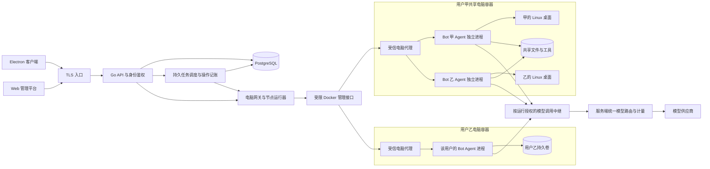
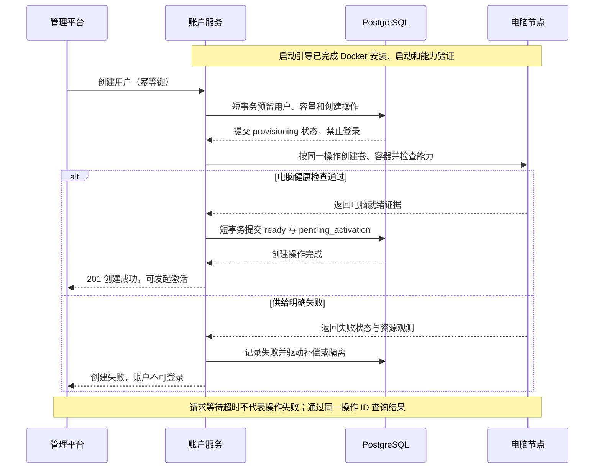
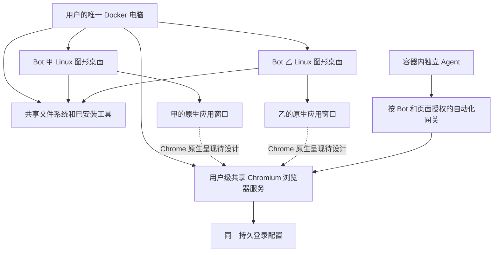
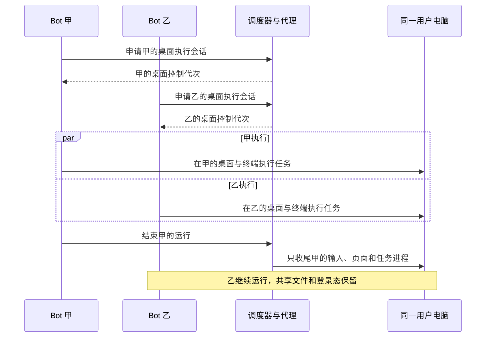

# TomBot 多用户服务端改造方案

初稿日期：2026 年 11 月 10 日；更新日期：2026 年 11 月 11 日。状态：目标架构与实施方案。实际完成范围及验证结果见[多用户重构实施进度](multi-user-progress.md)。

TomBot 将按最终目标重构为集中托管的多用户平台：业务数据统一存入全新 PostgreSQL 数据模型，管理员通过沿用当前客户端视觉风格的 Web 平台管理用户、模型与电脑资源，客户端登录后只访问当前用户的数据。服务端启动引导自动安装并启动 Docker；创建用户时同步创建并启动该用户的持久化电脑容器，用户名下所有 Bot 共用这台电脑及其共享文件。旧数据库、文件、账户和配置不迁入新系统。

**核心执行策略是同一用户的 Bot 并行使用同一台电脑，每个 Bot 拥有完整且独立的 Linux 图形桌面。** 每个 Bot 的 Agent 也在该用户的共享电脑容器中运行，采用独立进程，绑定自己的桌面与执行授权；服务端不运行 Bot 的模型与工具循环。文件系统、已安装工具和浏览器登录状态共享；桌面画面、鼠标键盘及浏览器窗口按 Bot 隔离。文件层面不强制隔离，不要求通过发布流程才能跨 Bot 读取。登录、退出和切换网站账号影响该用户所有 Bot，这是已确认的共享行为。

## 改造目标与边界

| 需求           | 目标行为                                                                | 主要验收依据                                            |
| -------------- | ----------------------------------------------------------------------- | ------------------------------------------------------- |
| PostgreSQL     | 按最终目标建立全新模型，只使用 PostgreSQL，不提供旧数据导入或兼容       | 空库初始化、新模型约束及备份恢复通过验证                |
| Web 管理平台   | 管理员管理账户、全局模型、配额、容器、任务和审计                        | 管理员操作生效，普通用户无法调用管理接口                |
| 多用户登录     | 账户独立，Bot、会话、群组、文件、记忆、定时任务、通知均归属用户         | 两账户交叉访问全部被拒绝                                |
| 服务端统一模型 | 管理员配置供应商和模型，客户端无需输入地址、密钥或模型名称              | 用户登录后可直接使用管理员分配的模型策略                |
| 每用户共享电脑 | 启动引导自动安装 Docker，创建用户同步创建电脑容器，一用户一电脑和持久卷 | 创建成功时电脑已就绪，所有 Bot 共享文件且不抢占任务资源 |

### 已确认的设计决策

| 决策                                     | 实施约束                                                                                                                              |
| ---------------------------------------- | ------------------------------------------------------------------------------------------------------------------------------------- |
| 客户端保留产品标识，服务端统一机器人语义 | 客户端继续使用猫咪形象；服务端领域、数据库、接口、模型提示、内置数据、日志及管理平台只使用 Bot／机器人，统一以 `bot_id` 标识资源      |
| 创建用户同步创建电脑                     | 启动引导自动安装、启动并验证 Docker；创建用户时创建持久卷和容器，通过终端、浏览器、文件等健康检查后才返回成功。首位管理员遵循相同流程 |
| 管理平台沿用客户端 UI 风格               | 以当前客户端的主题变量、布局、表单、弹窗、图标和浅深色主题为视觉基准，共享通用样式与组件；管理页面使用机器人术语                      |
| 数据模型直接面向最终目标                 | 从空 PostgreSQL 数据库和全新用户存储建立最终领域模型；不迁入旧数据，不保留旧表适配、旧 ID 映射、双写或单用户兼容路径                  |
| Agent 运行位置                           | 同用户仍共用一个 Docker 容器；每个 Bot 在容器内拥有独立 Agent 进程和完整桌面，服务端负责调度、模型路由与持久记账，不执行 Bot 循环     |
| 同用户并行桌面与共享环境                 | 所有 Bot 共用文件、工具和登录态；每 Bot 完整 Linux 桌面独立，截图、窗口和输入不可越权；登录、退出与切换账号影响所有 Bot               |

### 实施范围

本期遵循以下范围：

- 按用户最新确认的顺序推进：生产部署链路 → 共享浏览器 → 业务功能补齐 → 管理平台补齐 → 客户端切换 → 旧实现清理 → 最终交付验收。
- 远程电脑后续单独设计。用户最新明确的目标是远程控制真实的 1280×800 Linux 桌面，直接操作原生 Google Chrome、XFCE 终端和 Thunar 文件管理器；不开发自有浏览器窗口界面，也不能以仅有浏览器工具调用替代远程电脑。公开入口、连续画面、剪贴板及人工接管仍暂缓；容器供给、容器内独立 Agent、Bot 桌面隔离和共享浏览器的运行约定保留。
- 用户就是租户边界，暂不引入组织、团队、多租户成员关系或跨用户群聊。
- 管理员创建账户并发起激活，首期不开放自助注册；使用用户名与密码登录。后续接入企业身份源不改变数据归属。
- Web 平台首先面向管理员，不同步建设普通用户 Web 聊天客户端；Electron 是本期业务客户端。
- 客户端完全移除模型配置及模型选择。服务端按平台默认策略或用户分配策略路由；Bot 级特例只能由管理员设置。
- 先支持单个 Linux 电脑节点，数据模型保留节点归属；数据库任务领取从第一期就支持多进程互斥。跨节点自动迁移需另行通过存储和旧节点隔离验证。
- Bot、群聊、私信、资料库、记忆和定时任务按新多用户模型实现，不为了复用旧表、旧字段或旧服务对象限制设计。
- 客户端与服务端成套发布，不保留单用户认证、旧模型表单、宿主机执行或双数据库兼容层。历史 SQL 脚本仍按仓库规则保持不可变，但不进入新系统执行链。

## 产品标识与服务端术语

客户端继续以猫咪作为产品标识，头像、动画和交互文案由客户端表达。服务端只识别 Bot／机器人，一个 Bot 只有一个 `bot_id`，不再另设客户端助手标识及对应映射表。

| 范围             | 约定                                                                                                           |
| ---------------- | -------------------------------------------------------------------------------------------------------------- |
| 客户端展示       | 保留猫咪头像、动画、招聘与详情等品牌表达，由前端把 Bot 资源转换为展示视图                                      |
| 服务端代码与数据 | 类型、方法、字段、表名和目录使用 `Bot`、`bots`、`bot_id` 等统一业务命名；移除旧品牌专用服务与映射              |
| 接口与模型上下文 | 资源统一为 Bot；模型提示和工具描述使用英文 `bot`，不注入品种、猫咪角色或品牌语气规则                           |
| 管理平台与日志   | 中文统一称“机器人”，例如“机器人列表”“创建机器人”“停用机器人”；技术字段保持 `bot_id`                            |
| 跨端展示属性     | 服务端可保存通用名称、介绍和不透明的 `avatar_ref` 等展示元数据；头像品种枚举、资源映射和动画状态仅由客户端解释 |

重构时同步清除服务端现有品牌专用的模型提示、欢迎逻辑分支和命名；欢迎内容等功能改用通用 Bot 语义。客户端展示属性不改变服务端权限、调度或模型路由。该约束针对工程命名、内置数据和平台生成文本，不限制用户自定义名称或消息内容。下节出现的旧文件名仅用于定位现状，不是目标命名。

## 原有运行架构与改造依据

以下描述原有服务运行链路，用于定位需要替换的职责。实施基线为提交 `1946c40`，其中已有自定义头像、机器人主动发消息、群聊与私信协作，重构须保留这些功能。下表保留原运行基线；当前 `tomd` 已接入 PostgreSQL、身份、管理平台和 Worker，部署边界见[应用组合说明](../internal/serverapp/README.md)。独立节点、完整电脑能力及客户端仍在重构，不能把入口组合测试通过等同于新系统已可部署。

| 领域       | 当前实现                                                                                                                                                                                | 改造影响                                                                |
| ---------- | --------------------------------------------------------------------------------------------------------------------------------------------------------------------------------------- | ----------------------------------------------------------------------- |
| 数据库     | [store/db.go](../internal/store/db.go) 使用 SQLite WAL、单连接；[store/migrate.go](../internal/store/migrate.go) 校验历史脚本摘要并顺序迁移                                             | SQL 方言、事务竞争、迁移器和测试数据库都要改造                          |
| 身份       | [auth/service.go](../internal/auth/service.go) 使用单口令认证和全局设备授权；[httpapi/router.go](../internal/httpapi/router.go) 只向上下文注入设备标识                                  | 补充用户、会话、角色及资源所属用户校验                                  |
| 工作空间   | [service/cats.go](../internal/service/cats.go) 和 [0020 迁移](../internal/store/migrations/0020_desktop_columns.sql) 使用全局工作空间及单例元数据                                       | 拆成每用户元数据与资源级更新，避免整份覆盖造成并发丢失                  |
| 模型       | [service/catalog.go](../internal/service/catalog.go) 已有供应商和模型目录；桌面模型表单又通过工作空间服务同步配置                                                                       | 合并为服务端唯一权威配置，移除桌面同步配置路径                          |
| 程序组装   | [cmd/tomd/main.go](../cmd/tomd/main.go) 创建全局工作区、浏览器、终端服务和运行时                                                                                                        | 控制服务与用户电脑执行环境分离                                          |
| 终端与文件 | [term/shell.go](../internal/term/shell.go) 在宿主机启动命令；[workspace/files.go](../internal/workspace/files.go) 约束文件工具路径                                                      | Shell 不能继续与服务进程共处宿主环境，文件工具限制也不能当作 Shell 沙箱 |
| 浏览器     | 启动配置使用同一个 `browser-profile`；[service/browser.go](../internal/service/browser.go) 管理浏览器                                                                                   | 保留用户级共享登录态，将窗口画面和输入严格绑定所属 Bot 桌面             |
| 事件与任务 | [infra/bus/bus.go](../internal/infra/bus/bus.go) 保存全局事件；[agent/runtime.go](../internal/agent/runtime.go) 持有进程内队列与忙闲状态                                                | 事件查询、调度、恢复都要按用户划分并持久化所有权                        |
| 审计与用量 | [0021 迁移](../internal/store/migrations/0021_drop_approval_usage_audit.sql) 已删除相关表；[store/transaction.go](../internal/store/transaction.go) 的审计函数为空实现                  | 管理平台所需审计与用量需新建真实实现，不能沿用空实现                    |
| Web        | [web/health](../web/health) 是健康页面，另有 [computer_page.go](../internal/httpapi/computer_page.go)                                                                                   | 尚无管理平台，需新增独立前端                                            |
| 客户端     | [desktopServer.ts](../../desktop/src/main/desktopServer.ts) 保存单个服务地址和设备凭据；[useSession.ts](../../desktop/src/renderer/src/features/session/useSession.ts) 组织当前连接流程 | 增加账户登录、退出、会话撤销和账户切换清理                              |
| 构建约定   | [desktop/package.json](../../desktop/package.json) 提供桌面检查；[server/Makefile](../Makefile) 已修正原有失效入口，提供 Go 格式、静态、构建、竞态及 Python 脚本检查                    | 后续为管理平台增加独立检查入口，所有检查覆盖最终运行链路                |

## 目标架构

服务端继续采用 Go，并按最终业务领域重构模块。账号、模型、会话、调度等控制逻辑集中管理。每个 Bot 的 Agent 主循环与工具编排运行在其绑定的用户电脑容器内，使用独立的非 root 进程、稳定 Bot UID 和本桌面的执行会话；不能只把 Shell 放进容器而把 Agent 循环留在服务端。运行时沿用同一 Bot 身份，不另建机器人映射。首期不因模块划分拆出大量独立微服务。



职责划分：

| 模块             | 负责                                                                      | 不持有的能力                                                  |
| ---------------- | ------------------------------------------------------------------------- | ------------------------------------------------------------- |
| 身份与用户服务   | 登录、激活、会话、撤销、角色、账户状态                                    | 不代替业务所属权检查                                          |
| 用户业务服务     | Bot、群组、消息、记忆、例程、附件与产物元数据                             | 不直接执行宿主机命令                                          |
| 模型目录与路由   | 管理员配置、策略分配、模型能力检查、调用和用量                            | 不把模型凭据发送给客户端或用户电脑                            |
| 执行调度         | 持久队列、运行租约、Agent 进程分发、操作记账、取消和恢复                  | 不运行 Bot 的模型与工具循环，也不用进程内互斥代替跨实例一致性 |
| 电脑网关         | 校验用户与运行身份，转发受限电脑操作和实时通道                            | 不暴露容器地址、Docker API 或浏览器调试接口                   |
| 节点运行器       | 容器生命周期、受管进程、卷与端口、资源回收                                | 不执行客户端提交的任意 Docker 参数                            |
| 容器内电脑代理   | 监督各 Bot Agent 与桌面、受限工具入口、进程回收和结果中继                 | 不连接业务数据库，不持有平台模型密钥                          |
| 容器内 Bot Agent | 本 Bot 的上下文、模型步骤、工具编排与结果生成；使用本地共享文件及所属桌面 | 不持有 Docker、数据库、模型供应商凭据或其他 Bot 的桌面控制权  |

API 与调度 Worker 可先作为同一部署中的不同职责运行，但 Bot Agent 必须在绑定容器内执行。入口鉴权、持久化、模型中继、Agent 协议及电脑执行协议分别测试。用户电脑故障会阻止该容器内的 Agent 运行，包括纯文本任务；这些任务明确等待或失败，不回退到服务端运行。登录、历史查询和其他用户的健康电脑继续可用。

### 容器内 Agent 执行约定

- 一个用户容器承载多个独立 Bot Agent 进程，按需启动，并且同一 Bot 同时只有一个活动执行者。进程绑定 `user_id + computer_id + bot_id + desktop_id + generation + run_id + fencing_token`，不能在多个 Bot 之间复用同一个可变上下文或输入控制者。
- 每次运行都先取得对应容器与桌面的执行授权，然后启动 Agent；纯模型运行也不能绕过容器。图形会话可以按需启动，Agent 与其桌面的租约、撤销和回收归属一致。其他 Bot 在自己的授权下继续运行。
- 模型配置、供应商凭据、权限复验、额度预留与实际用量结算仍由服务端掌握。Agent 通过受信电脑代理及节点的运行级中继请求模型，不接收模型密钥，也不自行选择供应商地址或配置版本。客户端保持无模型配置。
- Agent 在容器内完成模型响应处理和工具编排；终端、文件与图形动作在所属电脑执行。平台侧的记忆、会话和协作数据通过受限业务调用访问，不能给 Agent 数据库连接或任意管理接口。
- 外部副作用先由服务端持久记录操作身份和请求摘要，确认获准后才执行；结果与用量通过同一运行身份回报。断连、进程退出、取消和过期不会自动重放未知模型或工具动作。恢复前须确认旧 Agent 与所属任务后代已停止。
- 模型与工具循环位于 `internal/botagent`，独立 `bot-agent` 程序已加入专用镜像。`internal/execution.Worker` 已改为容器进程分发和持久操作中继，纯文本运行也先取得电脑执行权；节点与电脑代理逐块复验会话，不提供服务端循环回退。主入口已组合新调度链，独立电脑节点、真实业务 cgroup 与完整电脑工具链仍需联合验收，不能把模块测试通过当作整体部署已切换。

## 数据归属与 PostgreSQL 模型

### 用户数据与平台数据

所有用户业务主表直接携带非空 `user_id`。关联表也携带 `user_id`，并用复合外键约束两端归属一致；禁止仅凭前端传来的 Bot 或会话 ID 查询。

| 范围       | 主要实体                                                                                                                                                                                                                | 关键规则                                                                |
| ---------- | ----------------------------------------------------------------------------------------------------------------------------------------------------------------------------------------------------------------------- | ----------------------------------------------------------------------- |
| 账户       | `users`、`user_credentials`、`user_sessions`、`devices`                                                                                                                                                                 | 用户名规范化后唯一；凭据摘要独立保存；设备属于一个用户                  |
| 工作空间   | `user_workspaces`、`user_preferences`                                                                                                                                                                                   | 一用户一工作空间，替代全局 `workspace_meta`；修订号用于并发控制         |
| Bot 与群组 | `bots`、`bot_introductions`、`groups`、`group_members`                                                                                                                                                                  | 统一使用 `bot_id`；名称按用户内唯一约束，桌面归属另以 `desktop_id` 关联 |
| 会话       | `conversations`、`turns`、`messages`、`message_reactions`                                                                                                                                                               | 单聊、群聊、Bot 私信的参与方必须属于同一用户                            |
| 执行       | `runs`、`tool_calls`、`jobs`、`execution_sessions`、`resource_leases`                                                                                                                                                   | 用户、Bot、回合、尝试号与电脑归属一致                                   |
| 视觉观察   | `run_screenshots`、`run_operations.sequence` | 截图与操作终态原子提交；按用户和运行归属，限制容量、保留时间与上下文张数 |
| 定时与记忆 | `routines`、`routine_runs`、`memory_documents`、`memory_index`                                                                                                                                                          | 定时触发与索引任务带用户上下文；Bot 记忆保持 Bot 权限范围               |
| 文件与产物 | `file_entries`、`file_versions`、`attachments`、`bot_artifacts`                                                                                                                                                         | 元数据归属用户，业务文件可由所有 Bot 直接读写，版本与快照按需提供       |
| 电脑       | `computers`、`computer_operations`、`bot_desktops`、`desktop_identity_heads`、`desktop_execution_heads`、`computer_sessions`、`terminal_sessions`、`browser_profiles`、`browser_windows`、`browser_tabs`、`port_leases` | `computers.user_id` 唯一；一电脑多桌面并发，同一桌面一次一个输入控制者  |
| 通知与事件 | `user_events`、`notification_states`、`pending_questions`                                                                                                                                                               | 事件、游标、未读与待答问题都按用户限定                                  |
| 用量       | `model_usage`、`user_limits`、`usage_reservations`                                                                                                                                                                      | 用量关联用户、Bot、运行和模型配置版本                                   |
| 平台配置   | `model_providers`、`model_credentials`、`models`、`model_policies`、`model_policy_versions`、`user_model_assignments`                                                                                                   | 仅管理接口能变更，模型密钥与用户工具凭据分库表管理                      |
| 运维       | `computer_nodes`、`computer_images`、`bootstrap_operations`、`user_creation_operations`、`admin_audit_events`、`schema_migrations`                                                                                      | 保存引导和用户创建真实状态；审计不包含敏感正文或凭据                    |

上述实体直接构成全新 PostgreSQL 数据模型，字段、约束、索引及生命周期按最终业务设计，不由旧表逐列转换，也不保留 SQLite 布局、桌面模型设置或单用户状态字段。业务文件内容在用户持久卷中，PostgreSQL 保存所有权、路径、版本、摘要与引用。模型临时截图属于有界执行观察，像素单独保存在 PostgreSQL 并按到期与运行结束条件清理，避免工具结果已提交而图片缺失；不作为用户文件库。首期无需引入对象存储；后续扩容可以替换文件存储接口。

自定义头像作为有界用户配置资产单独保存在 PostgreSQL 的 `bot_avatars`，不进入所有任务可访问的共享电脑目录。保持当前客户端的 128 × 128 PNG 能力，输入限额、规范重编码、内容摘要与所属用户授权由服务端执行；内置头像只保存不解释业务含义的客户端资产标识。此例外不改变普通业务文件与产物存入用户卷的规则。

普通共享文件与 Bot 私有记忆分开：共享文件供该用户的所有 Bot 直接读写；私有记忆、其他会话原始记录和平台凭据不因共用电脑而自动可见。记忆正文由服务端控制的存储区域或数据库保存，通过带 Bot 权限的接口访问，不挂进所有 Shell 都能读取的共享目录。

### 约束与查询规则

- 资源 ID 由新服务统一生成；建立 `(user_id, id)` 唯一键，子表通过 `(user_id, resource_id)` 外键关联。跨用户群成员、附件引用、回复引用和产物挂载在数据库层也必须失败，不保留旧 ID 映射。
- 消息顺序以 `(user_id, conversation_id, seq)` 唯一。发送幂等键以 `(user_id, client_request_id)` 唯一，并保存请求摘要；同键不同请求返回冲突。序号在事务中锁定会话计数器后分配，不使用无锁的 `MAX(seq)+1`。
- 同一会话活动回合用唯一约束限制；同一 Bot 需要稳定上下文的运行也进入串行队列。不同 Bot 的模型、终端、桌面、浏览器和文件任务均可并行。
- 读写必须显式限定用户；列表采用有界分页，索引以 `user_id` 和查询排序字段组合设计。默认不整表加载某用户全部历史消息。
- 工作空间改为资源级创建、修改和删除；修订字段使用条件更新，冲突返回 `409`，客户端重新读取后合并，不再盲目整份覆盖。
- 后台任务的用户身份从持久化任务记录读取，不能使用任意请求参数或模型输出选择租户。

### 行级安全与数据库角色

采用业务显式过滤与 PostgreSQL 行级安全 RLS 双重约束。运行角色不能是表所有者、超级用户或具有 `BYPASSRLS` 的角色；租户表启用并强制 RLS，同时定义读取条件和写入检查。RLS 默认拒绝、表所有者及特权角色的例外是数据库本身的行为，必须在部署测试中验证。[PostgreSQL 行级安全文档](https://www.postgresql.org/docs/current/ddl-rowsecurity.html)

每次租户数据库操作都进入事务，由统一仓储入口设置事务局部用户上下文；事务结束后自动失效。禁止在连接池连接上保留会话级用户变量。缺少上下文时返回空结果或拒绝写入，不能默认为平台用户。RLS 是防止遗漏过滤的防线，不能防御已经控制应用进程的攻击者。

迁移角色、租户运行角色和管理角色分离。跨用户任务发现使用仅含调度元数据的受限队列表或受限数据库函数；Worker 领取后切入具体用户事务读取业务数据。管理统计使用明确授权的汇总入口，普通请求不可借管理员角色绕过隔离。备份角色应覆盖全部所需数据，并验证没有被 RLS 静默过滤。

登录、激活和会话续期尚未具备可信用户上下文，使用专门的最小权限认证入口，按规范化用户名或凭据摘要仅查询必要认证字段；验证成功后才建立 Principal 和租户事务。不得为了登录借用全权限管理角色，也不能把请求中的用户标识直接设为 RLS 上下文。采用受限数据库函数时，限定执行权限并固定安全的 `search_path`，防止对象替换影响认证逻辑。

### PostgreSQL 原生存储与搜索

仓储按领域边界重新实现，统一采用 `pgx` 的 `database/sql` 适配及 PostgreSQL 原生 SQL；删除 SQLite 驱动和方言依赖，不新增运行时兼容器。

| 设计项     | 目标规则                                                                                                  |
| ---------- | --------------------------------------------------------------------------------------------------------- |
| 字段类型   | 使用 `boolean`、`timestamptz`、`bytea` 等原生类型；结构化扩展内容使用 `jsonb`，可约束的核心字段保留普通列 |
| 标识与时间 | 新资源统一生成稳定 ID，时间存储为 UTC，接口时间格式一致，不复用旧时间或 ID 转换逻辑                       |
| 参数与错误 | 全部查询参数化，SQLSTATE 统一映射领域错误，不向客户端透出底层异常                                         |
| 事务与并发 | 有界连接池、短事务、行锁、唯一约束、条件更新和有限重试；外部调用不占数据库事务                            |
| 写入结果   | 使用 `RETURNING` 获取写入结果；`ON CONFLICT` 必须明确冲突目标与业务行为                                   |
| 搜索       | 消息和记忆直接建立新索引与搜索契约，不保留 FTS5 查询或触发器                                              |

消息和记忆搜索首期提供中文子串能力：规范化搜索文本，使用 `pg_trgm` 索引支持 `LIKE/ILIKE`，必要时为英文增加全文检索。该扩展不是中文分词器；无可提取三元组的模式可能退化为索引扫描。短词查询必须限制用户范围、候选范围、返回数和查询时间，并用中文单字、双字、长句、英文、符号及大历史量验证语义和性能。[PostgreSQL pg_trgm 文档](https://www.postgresql.org/docs/current/pgtrgm.html)

使用新模型生成正常、边界及容量测试样本，明确排序和摘要规则，不把复现旧搜索结果作为约束。初始化及后续索引变化通过新增版本脚本实施；脚本说明锁等待、执行时长和失败重试方式。未来大表在线建索引时，执行器支持不能放入普通事务的操作及失败后检查。

## 账号登录与权限

### 身份生命周期

1. 运维通过受保护的部署命令创建首位管理员，不在日志或文档输出初始密码、令牌或激活值；不保留面向所有客户端的单口令初始化入口。
2. 管理员创建用户时同步创建并启动其电脑容器，健康检查通过后账户进入待激活状态，随后生成有时限的一次性激活流程；电脑创建失败时账户不可激活或登录。激活凭据只存摘要、只在专用界面短暂展示，不进入日志或 URL 查询串。用户首次设置自己的密码。
3. 登录提交用户名、密码和设备信息。用户名采用统一规范化规则；密码沿用安全散列能力并支持参数升级。按账户与来源限流，错误不泄露账户是否存在。
4. 会话记录归属用户和设备，包含有效期、撤销时间及权限版本。短期访问凭据与可轮换的续期凭据分开；只存摘要，检测续期凭据重放并撤销对应会话链。
5. 修改密码、管理员禁用账户、撤销设备或退出登录会撤销相应会话。WebSocket、SSE、终端和浏览器控制通道也响应撤销，不能只禁止新 HTTP 请求。
6. 禁用用户后禁止新任务，取消排队任务并中止活动执行，回收电脑控制权；已有外部操作不保证可撤销，状态明确记录成功、失败或结果未知。

普通退出只结束该设备会话及人工控制会话，已接受的 Bot 后台任务和定时任务继续执行；界面明确此语义。删除账户采用先禁用、停任务、停止容器、撤销会话，再按保留政策清除数据库和文件的异步流程；删除持久卷必须独立确认并审计。

### 权限边界

首期仅有 `admin` 和 `user` 两类角色。管理员可以管理用户、配置和资源，但管理界面默认不提供他人聊天正文、文件内容或浏览器登录态。需要支持诊断内容访问时，必须新增明确权限和审计入口，不能复用普通用户接口任意传 `user_id`。

服务端将身份解析成不可由请求体覆盖的 `Principal`，包含用户、会话、设备及角色。所属权校验覆盖 HTTP、后台 Worker、Bot 间工具调用、批量操作、文件传输、WebSocket、SSE、搜索和电脑代理。查询其他用户资源按不存在处理，避免泄露资源是否存在。

Web 管理平台采用安全 Cookie 会话，启用 `HttpOnly`、`Secure`、合适的 `SameSite` 及 CSRF 防护；敏感操作进行二次身份校验，生产管理员启用多因素认证。Electron 的凭据保留在主进程并使用操作系统凭据存储，渲染进程不接收会话凭据。

## 服务端集中模型管理

管理员配置供应商协议、地址、凭据、模型名称、工具和视觉能力、上下文与输出限制，以及可选价格信息。配置草稿通过连通性和能力校验后发布为不可变版本，再分配为平台默认策略或用户策略。

调用链统一为：`用户与 Bot → 服务端策略解析 → 固定配置版本 → 模型调用 → 用量结算`。唯一策略优先级为管理员设置的 Bot 特例、用户策略、平台默认策略；选中策略不可用时明确失败，只有该策略显式定义的备用路由可以启用。不再从客户端的 `modelId` 或工作空间模型表单生成供应商模型记录。用户电脑不持有平台模型密钥，也不允许通过代理接口传入任意供应商地址。

具体规则：

- 新运行开始时记录模型策略和配置版本；在途运行固定版本，配置修改对后续运行生效。紧急禁用则阻止后续调用，并把运行标记为明确的配置不可用状态。
- 无可用模型时，客户端显示“管理员尚未配置可用模型”，可查看历史内容；不能跳转到用户填密钥的初始化页。
- 管理员修改密钥只能替换，响应仅返回是否配置和版本等元信息；不返回明文或可还原值。密文存入数据库，解密主密钥外部托管并具备轮换与恢复流程。
- 模型配置版本引用明确的凭据版本。正常轮换创建新版本，新运行用新凭据；旧凭据仅在供应商允许的过渡期内服务已有运行，排空后销毁。不支持并存的供应商先排空受影响运行再轮换。紧急撤销对所有引用版本立即阻止后续调用，不能因运行固定版本继续使用已撤销凭据。
- 平台模型凭据与用户提供给业务工具的凭据隔离。工具凭据只能按授权用途短时使用，不进入提示词、文件共享目录或常规日志。
- 模型发现、探测和调用均有连接、首字节、整体及流空闲超时。仅明确可安全重试的失败有限退避；已产生输出、可能产生工具动作或结果不确定的请求不盲目重试。
- 首期可以只设用户并发和用量额度，不建设支付结算。用量记录必须真实；未知用量记录为未知，不能按零处理。
- 并行调用前原子预留额度，完成后依据真实响应结算并释放差额；后台对账处理失联预留。缺失价格时展示计量值，不编造费用。已有审计和用量空实现不能充当此能力。
- 供应商地址仅管理员可设，服务端执行地址与重定向校验；内网模型走部署明确配置的允许范围，不能借模型探测访问控制平面或云元数据端点。

## 每用户一台 Docker 电脑

### 启动引导自动安装 Docker

首期服务端以 Linux 主机上的服务程序部署。启动入口统一执行环境引导，缺少 Docker 时自动安装 Docker Engine，启动守护进程并配置系统自启；不将手工安装 Docker 作为正常部署步骤，也不把安装任务延迟到创建用户或调用电脑工具时。

引导流程为：

1. 检测受支持的发行版、架构、系统服务管理器、磁盘空间、网络、安装权限和 cgroup v2 能力。
2. 取得节点级独占引导锁，并遵守系统包管理器锁；检测现有 Docker 版本、配置和工作负载。
3. 未安装时，按发行版安装适配器配置 Docker 官方签名软件源，安装经项目验证并锁定版本的 Docker Engine 及所需依赖。已安装且兼容时验证复用，不在每次启动时重复安装或自动升级。
4. 启动 Docker、设置自启，核验 API、存储、网络隔离及资源限制；运行受控探针验证进程回收能力。
5. 预拉取并校验固定摘要的电脑镜像，确认容器创建、终端、浏览器和文件能力后，将节点标记为就绪。

安装器使用官方软件源及签名校验，不直接执行远程便利脚本；Docker 官方将便利脚本主要用于测试和开发场景。[Docker 安装文档](https://docs.docker.com/engine/install/ubuntu/)

部署入口包含具有安装权限的受限引导单元，例如随安装包交付的系统服务前置单元；API 和 Worker 在普通服务账户下运行。引导单元只读取受保护的安装清单并执行固定动作，管理接口不能向它传任意命令、软件源或宿主路径。Docker 管理权限仅由受信节点运行器持有；不能通过把 API 账户加入 Docker 用户组来规避权限划分，该用户组具有 root 级权限。[Docker Linux 安装后配置](https://docs.docker.com/engine/install/linux-postinstall/)

每阶段记录状态、失败原因和有限重试进度，重启后先验证实际环境再续做。缺少安装权限、不支持的系统、软件源失败、镜像不可用或能力检查失败时明确阻断首次就绪和用户创建，诊断入口仍可读取状态。发现不兼容运行时或影响其他工作负载的冲突时，不静默卸载现有软件或清理容器。自动安装不能通过跳过检查、无限重试或要求用户手工补装来宣告完成。

Docker 安装属于部署引导；浏览器、字体和任务工具依赖仍在电脑镜像构建时安装。首次引导完成后的 Docker 故障按运行期降级处理：阻止新建用户和电脑执行，已有用户的登录和历史查询仍可用；只有仍具有效授权的健康容器可以继续 Agent 运行，失去电脑执行能力的任务明确等待或失败。

### 资源与生命周期

`computer` 是用户的持久逻辑资源，`container` 是可替换的运行实例，`volume` 保存用户文件。创建用户时同步建立电脑记录、持久卷与 Docker 容器，并启动到可用状态；不得先返回创建成功，再等用户首次使用时创建电脑。首位管理员也是用户，Docker 引导就绪后按同一规则创建电脑。即使有多个 Bot，也不会为每个 Bot 再创建一台 Docker 电脑。

同步创建使用持久操作状态机，而不是持有数据库事务等待 Docker：

1. 请求携带幂等键，在短事务中校验容量并预留用户名，写入 `provisioning` 用户、电脑记录和创建操作；此时不允许激活或登录。
2. 运行器按操作 ID、用户 ID 和电脑实例代次核验标签和已有资源，创建持久卷与采用 `network=none` 的唯一容器，再启动电脑代理和受控出网端点。
3. 检查终端、浏览器、文件、配额及进程回收能力，成功后在事务中将电脑记为 `ready`、账户记为 `pending_activation`，完成创建操作。正常请求此时才返回 `201`，管理员界面显示创建成功并允许激活。
4. 请求等待和创建操作分别有有限超时。请求超时返回明确的 `504` 及操作 ID，界面查询同一操作，不显示成功；断开请求不取消已经开始的创建操作。同一幂等键及相同请求指向同一操作，不同请求内容返回 `409`。
5. Docker 调用超时先核实资源是否已创建，不能盲目重建。电脑已就绪但最终数据库提交失败时，操作保持未完成，由对账器核实后完成同一操作；中间状态不作为成功账户开放。
6. 确认失败后，账户保留 `provision_failed` 且不可登录，自动清理仅由本次操作创建且尚未启用的资源；必须先确认容器已停止，才删除本次新建且未投入使用的卷。不清理其他容器或已有业务卷。清理失败进入隔离状态并保留资源及用户名预留。显式重试沿用同一用户和电脑，创建新的尝试号，先完成对账再执行。

创建同步语义是“用户创建成功与电脑就绪同时成立”，不假设 PostgreSQL 与 Docker 存在共同事务。容量不足时本次创建明确失败，不能留下可登录但尚未分配电脑的账户。可配置的空闲休眠只停止已经创建的容器；后续使用启动同一电脑并保留卷，不影响首次同步创建约束。



建议状态：`pending → provisioning → ready → stopping → stopped`，恢复使用 `starting`，失败使用 `error`，无法确认旧执行已停止时使用 `quarantined`。状态变化保留原因、操作 ID、实例代次与观测时间，不用“正在准备”覆盖所有失败。

容器创建、启动、停止和重建通过持久化操作记录驱动。重试先按电脑 ID 和实例代次查找已有资源，再决定下一步，避免请求超时后重复创建容器或卷。业务事务不跨 Docker API 调用；对账器修复数据库与节点实际状态不一致的情况。

重建先排空运行并停止旧实例，验证持久卷备份后使用固定镜像摘要启动新实例。一次只允许一个实例挂载并写入用户卷。容器丢失可从卷恢复文件，但活 PTY、进程内状态和未确认的浏览器操作不能宣称可无损恢复。

### 运行环境边界

- 正式电脑节点使用 Linux 和经验证的 cgroup v2 能力。Docker 及其宿主依赖由启动引导安装；浏览器、字体和用户任务依赖在电脑镜像中准备，用户任务不能借引导接口修改宿主机环境。
- 用户任务以非 root 身份运行，无提权、无宿主机目录、无 Docker socket、无宿主 PID/网络模式。节点运行器属于独立受信组件，其权限不透传给用户命令。
- 使用经过验证的 Chromium 沙箱及安全配置，不以关闭沙箱作为部署方案。固定镜像版本，扫描和升级后执行终端、浏览器及中文字体回归。
- 设置每用户 CPU、内存、进程数、磁盘及临时目录配额；磁盘配额由支持配额的实际存储后端执行，不能只依靠 Docker 的内存限制。
- 用户容器禁止连接数据库、节点管理接口、宿主机管理端口、其他用户网络和云元数据地址。浏览器与 Shell 的出网策略统一，限制规则同时覆盖 DNS 解析、IPv4、IPv6 和重定向。
- 出网实现采用 `network=none` 加容器环回 HTTP/CONNECT 转接，通过本实例 root 私有 Unix socket 连接宿主代理。宿主按内核对端和实际容器身份授权，每次解析后固定数字地址连接，拒绝私网、宿主地址及部署排除网段；端口、连接数、传输时限和字节数有上限。代理失效时出网失败，不回退直连。Chrome 共享浏览器进程须显式配置代理，普通工具使用统一代理环境。
- 容器控制接口只在受保护的管理通道可达，校验短期服务身份、电脑 ID、实例代次与操作范围。用户进程不能通过本机端口绕过电脑网关。
- 浏览器调试端口、PTY、文件服务和任务预览端口均由认证网关代理，不直接公开容器 IP。预览应用使用隔离来源，不能获得管理站点 Cookie 或同源权限。

Docker 提供的是容器隔离，并非独立内核虚拟机；网络连通和资源限制需要明确配置。受信节点运行器管理 Docker，业务 API 和用户任务都不持有通用 Docker 管理能力。[Docker 安全文档](https://docs.docker.com/engine/security/)

## 多 Bot 共享电脑与独立图形桌面

### 已确认的共享与隔离边界

本节按最新产品要求实施，替代整台电脑独占、只读共享文件和每 Bot 独立登录态的旧设计。同一用户名下所有 Bot 使用同一个 Docker 容器；不同用户继续使用不同容器和持久卷。

| 资源                     | 同一用户内的行为                                                                           |
| ------------------------ | ------------------------------------------------------------------------------------------ |
| 电脑、文件系统和业务目录 | 全部 Bot 共用，可直接读取、创建、修改和删除文件，不强制按 Bot 划分文件访问权限             |
| 已安装工具和依赖         | 作为用户电脑环境共享；系统包安装使用受管安装入口并遵守包管理器锁                           |
| 浏览器账号和站点持久状态 | 共用一个用户级浏览器配置；登录、退出和切换账号会影响所有 Bot                               |
| Linux 图形桌面           | 每个 Bot 独立显示会话、桌面窗口管理器、分辨率、截图、鼠标键盘和剪贴板                      |
| 浏览器窗口和画面         | 窗口归属一个 Bot，只向该 Bot 的桌面提供画面和输入通道                                      |
| 终端、任务进程和端口     | 按 Bot 与运行记录归属，可并发执行；取消只清理所属运行                                      |
| 平台控制材料             | 模型凭据、数据库连接、桌面认证、浏览器调试入口和代理控制记录继续受保护，不作为业务共享文件 |

文件共享意味着两个 Bot 可以编辑同一个文件，并承受正常共享文件系统的写入冲突。平台不以独占整台电脑、强制文件发布或不可变输入快照来回避这种并发。工作目录、Git worktree、文件版本和协作锁可作为任务自选工具，但不能成为读取其他 Bot 文件的门槛。桌面隔离保护平台提供的画面与输入通道，不把共享工具和可互相修改的业务文件宣称为恶意程序之间的强安全隔离。

### 一用户一电脑与每 Bot 一桌面

每个 Bot 对应一个稳定的逻辑 `desktop_id`。创建 Bot 时登记桌面资源，首次使用时启动 Linux 图形会话；关闭或重建桌面不创建第二台用户电脑，不复制文件卷或已安装工具。桌面可以在空闲后休眠，恢复时沿用同一个用户文件系统。

登记与机器人创建同事务提交，数据库双向复合外键禁止缺失或盗用桌面。每台电脑单调分配显示编号 1–4095、独立 Linux UID 及公共文件 GID；归档和重建不回收或改变身份。具体编号约定、容量、接口及发布边界见[桌面身份模块](../internal/computerdesktop/README.md)。编号上限是登记容量，同时运行数量由用户资源额度限制。

远程电脑使用专用 **Debian 13（Trixie）** 镜像，完整桌面采用 **XFCE**，窗口管理器为 **xfwm4**，显示协议为 **X11**，各 Bot 对外桌面固定 **1280×800**。每个桌面具有独立 X11 显示服务、窗口管理器、桌面截图和输入代理，直接呈现原生 Chrome、终端与文件管理器。原生 Chrome 跨独立桌面的共享状态和显示方案须在远程电脑详细设计中验证，当前不预设具体实现。

镜像默认预装以下工具，创建用户电脑后即可使用：

| 类别           | 默认工具与版本要求                                                                                                             |
| -------------- | ------------------------------------------------------------------------------------------------------------------------------ |
| 语言和运行时   | Python 3.13（pip、uv）；Node.js 24（npm、pnpm、bun）；Go 1.27；Rust（rustc、cargo）；Perl、gcc                                 |
| 常用命令行工具 | git、GitHub CLI（gh）；curl、wget、jq、ripgrep、tmux；ssh、scp、openssl；ffmpeg；pdftotext（读取 PDF）；PostgreSQL 客户端 psql |
| 桌面软件       | Google Chrome；LibreOffice Writer、Calc、Impress、Draw；XFCE 终端；Thunar 文件管理器                                           |

精确版本锁定、构建及验收入口见[专用镜像说明](../deploy/computer/README.md)。所有 Bot 使用同一份系统工具，用户后续安装的工具放在用户共享持久目录。终端和 XFCE 从[同一份环境模板](../internal/computer/desktop-environment.json)取得共享 HOME、工具前缀与命令搜索路径；屏幕编号、认证和会话总线绑定各自的私有图形运行目录。



每个显示会话使用单独的运行身份、显示认证材料、D-Bus 会话及剪贴板。业务目录给这些身份相同的共享访问权；显示控制目录和认证材料则单独保护。不能只设置不同的 `DISPLAY`，也不能使用关闭 X 认证或允许任意本地用户连接的配置。

显示服务和远程桌面传输只开放受管入口。请求绑定 `user_id + computer_id + desktop_id + bot_id + generation + fencing_token`；截图、鼠标、键盘、剪贴板和视频帧均核验同一归属。Bot 不能枚举其他 Bot 的桌面或窗口，不能提交别人的显示编号、窗口 ID、调试地址或原始连接凭据。人工用户可以选择自己任一 Bot 的桌面，但控制权仍须显式申请。

用户提供的远程桌面示例确定以下交互目标，详细技术方案后续单独设计：

- 打开某个 Bot 的电脑后显示该 Bot 的真实完整桌面，提供全屏与适配显示；缩放后的鼠标坐标仍映射到 1280×800 的实际桌面。
- 通过桌面原生应用入口打开 Google Chrome、XFCE 终端和 Thunar 文件管理器，直接使用各软件的窗口、菜单、标签页和文件选择框。客户端负责远程控制，不再绘制一套浏览器导航界面。
- 明确区分观看和控制状态。用户取得控制权时，界面显示“你正在控制”和“停止”，对应 Bot 的桌面键鼠和浏览器自动化均停止接收新操作；在途操作须先确认结束或明确报告结果未知，避免 Agent 通过 CDP 继续改变用户正在操作的页面。交还控制权后先重新观察真实桌面，再继续任务，不自动重放控制交接前结果未知的动作。
- 用户只可访问自己账户下的 Bot 桌面。切换桌面不复制文件、软件或登录状态；终端与文件管理器直接访问同一个用户共享文件系统，屏幕和输入仍保持 Bot 之间隔离。

当前节点与电脑代理已接通真实桌面截图、PNG 分块读取及完整键鼠手势，逐次检查完整执行会话，并连接所属 Bot 的私有 RFB 入口。截图和输入分别核对持久递增序号并允许模型步骤造成的空隙，重复末次请求复用已知结果，未知输入禁止重放；双 XFCE 的中文输入、鼠标和画面独立性已通过受限容器验证。实现边界与部署回滚见[电脑代理说明](../internal/computeragent/README.md#桌面截图与完整输入手势)。模型工具 `computer_screenshot`、`computer_input` 已接入容器 Agent 的执行链路：截图与工具结果原子保存，模型调用前按用户、Bot 和运行装配真实像素；Agent 协议版本 3 在模型轨迹中只保留图片引用，本地浏览器图片通过独立分块报告提交。临时 PNG 受独立存储额度、保留时间及上下文张数约束，见[执行模块](../internal/execution/README.md#截图持久化与模型视觉)。用户桌面网关、人工接管、剪贴板和视频流仍须继续实现，图形测试不替代生产业务 cgroup 的联合验收。

### 并发调度与控制权

不同 Bot 的模型、Shell、图形操作、浏览器和文件任务均可同时执行。调度分别控制用户资源额度、Bot 上下文顺序、桌面控制权和平台模型调用名额，不能继续使用每用户一个活动电脑会话的唯一约束。

同一 Bot 的同一桌面一次只有一个输入控制者，Bot 与人工不能同时向该桌面注入输入。不同 Bot 的桌面不互相排队；只有同一桌面被占用、用户并发额度耗尽或资源不足时等待。等待原因必须可见，不能把所有等待都显示为“电脑被占用”。

用户桌面并发额度保存在 `user_limits.concurrent_desktops`，开户必须显式配置，取值 1–64。执行控制按桌面独占，并在短事务内核对用户额度；启动待确认、活动、清理中及结果未知的会话都计入额度。运行查询返回 `desktop_busy`、`user_capacity` 和 `starting_desktop` 等等待原因；事件携带状态及对应的排队原因，启动确认使用 `starting` 状态。控制面已通过 `0042` 建立对应约束；节点与代理的多会话接入仍需继续完成。



控制代次按桌面递增，容器实例代次仍按电脑管理。每次动作同时检查这两层身份。父 Bot 可以等待子 Bot 在自己的桌面执行，无须先释放整台电脑；同一桌面内部仍需避免父子互等。长任务、暂停和人工接管只占用所属桌面的控制权，仍计入用户资源限制。

### 共享文件与工具

建议目录用于整理内容，不构成 Bot 之间的文件权限边界：

```text
/workspace/                 所有 Bot 共用的持久业务文件系统
  projects/                 共享项目与工作树
  downloads/                共享下载
  tools/                    用户安装的共享工具
  runs/<run_id>/            默认任务工作目录，其他 Bot 也可读写
```

文件工具、终端和图形应用使用同一套路径，Bot 甲生成的文件可直接被 Bot 乙读取，无须先发布或复制。上传和下载按用户鉴权，文件来源仍记录 Bot 与运行以供追踪，但来源字段不授予独占访问权。

平台文件编辑接口支持预期摘要或版本检查，发生冲突明确返回；Shell 直接写文件遵循文件系统语义，不承诺所有程序的写入都具有事务性。支持按需创建快照、版本和附件，不要求普通文件必须通过不可变发布流程。共享目录变更不能被当作单个 Bot 私有事件遗漏给其他使用者。

工具安装目标是用户电脑共享环境。用户态工具写入共享 `/workspace/tools` 并统一进入任务和图形应用的搜索路径；系统软件通过受管镜像构建及升级提供，升级进入明确的电脑维护状态。安装、升级和卸载由受管操作协调，遵守包管理锁；普通并行任务不因另一 Bot 使用电脑而一律等待。任务不获得宿主或容器 root 权限，平台模型密钥和控制记录不进入共享环境。

### 共享登录态与独立浏览器窗口

每台用户电脑只有一个受管 Chromium 浏览器服务和一个持久用户配置。各 Bot 的浏览器窗口属于同一常规浏览器上下文，共享 Cookie 和站点持久存储；不为每个 Bot 新建隔离 BrowserContext，也不复制、定时同步 Cookie 来模拟实时共享。窗口私有的页面变量和 `sessionStorage` 保持浏览器原生窗口语义，不复制其他窗口的运行状态。

用户已确认：同一网站的登录、退出、账号切换及其他共享会话变更对所有 Bot 生效。平台可通知相关桌面账号状态变化，不阻止用户明确要求的共享行为。网站自身的跨页面通知及账号业务状态不属于桌面画面隔离。

Chromium 一个实例不能在多个 X 显示器上展示原生窗口，多个运行实例也不能同时使用同一用户数据目录，因此不采用“每桌面一个 Chromium 进程，共同挂载一个 profile”的方案。[Chromium 用户数据目录说明](https://chromium.googlesource.com/chromium/src/+/refs/heads/main/docs/user_data_dir.md)

用户最新要求覆盖此前“共享内核＋自研窗口客户端”的呈现方案：远程电脑展示真实 Linux 桌面，浏览器使用原生 Google Chrome，终端使用 XFCE 终端，文件使用 Thunar。用户通过远程画面直接操作对应软件；Agent 使用浏览器自动化或桌面输入操作真实应用。平台只提供远程画面、输入授权与控制权交接，不重新实现地址栏、标签页或网页文件选择界面。

当前[共享浏览器内核](../internal/sharedbrowser/README.md)仍提供受管 Chrome、私有 CDP、页面归属、同一常规上下文和持久账号状态；这证明自动化基础，不证明原生 Chrome 已在各 Bot 桌面显示。自研 GTK 客户端、对应镜像包和桌面就绪依赖已删除；尚未验收的自研文件选择增量同步撤回。

浏览器执行在用户容器内完成：Bot Agent 使用本地浏览器工具操作容器内安装的 Chrome，页面创建、导航、点击、输入和截图不经过“服务端 → 宿主节点 → 电脑代理”的逐动作转发链路。服务端负责身份、统一模型、任务分发、操作登记与结果持久化；操作登记和结果回传不承担浏览器动作执行。容器内仅保留共享 Chrome 的生命周期、页面归属和本地访问校验，防止一个 Agent 操作其他 Bot 页面，不重新实现浏览器界面。

`computer_browser` 已按服务端登记、Agent 本地执行、结果确认接入协议 3。服务端只持有工具定义和账本，浏览器执行器只注册在容器内 Agent；没有浏览器逐动作节点 RPC。传输断开或结果未知时不补发副作用，“等待对话框”只表示动作尚待处理，Agent 完成前必须确认没有遗留在途或未知动作。生产部署及完整能力探针的验收仍需独立完成。

远程电脑详细设计须先验证“原生 Chrome 窗口＋多 Bot 独立桌面＋实时共享登录态”的组合。不能让多个 Chrome 实例同时写同一 profile，不能用 Cookie 复制、独立账号或放开跨 Bot 屏幕访问代替既定要求。原生窗口的显示与归属方案尚未确定，此项保留为后续独立设计和真实多桌面验收，不继续补自研浏览器界面来绕开它。

窗口绑定 `user_id + desktop_id + bot_id + window_id`，页面及弹窗继承所属窗口和桌面。页面截图、视频帧、输入、关闭、导航、页面树和弹窗事件都按该绑定路由；命令按窗口排序，不使用整个浏览器的长时间全局操作锁。浏览器上下文与目标页是不同概念，不能用共享上下文作为允许跨 Bot 操作页面的理由。[Chromium DevTools Target 协议](https://chromedevtools.github.io/devtools-protocol/tot/Target/)

原生 Chrome 的地址栏、标签页、弹窗、下载、上传、键盘组合、中文输入和对话框应在远程桌面中直接可用；验收必须操作真实应用，页面截图或自动化接口通过不能替代原生桌面验收。共享浏览器服务由专属非 root 身份运行，保留有效沙箱。持久 profile 是服务管理的状态，文件共享不意味着任务可直接连接调试端口或修改正在使用的配置数据库。

生产接入前先验证：两个真实页面同时输入互不串目标；页面截图不含另一 Bot 内容；相同网站登录和退出传播；原生 Chrome 在两个真实 Linux 桌面可分别鼠标键盘操作；关闭甲的窗口不结束乙的页面。共享浏览器服务崩溃属于用户电脑的共享故障，须同时报告受影响的运行，不能给未知网页动作自动重发。

### 进程回收与人工接管

每个运行的 Shell、终端和后台进程有独立 cgroup，桌面服务按 Bot 独立管理，用户级共享浏览器服务位于单独服务资源组。不能把所有 Bot 的共享浏览器放进某一个运行的资源组，也不能因一个 Bot 结束就终止整个用户浏览器。

任务引导继续在执行用户代码前完成入组、降权及撤销检查。任务目录不再作为文件隔离沙箱；身份主要用于进程归属和桌面控制保护，并获得用户共享业务目录的访问权。终端与输出流按运行绑定，不跨 Bot 复用 PTY。

结束一个运行时，先撤销其输入及新命令，再关闭该运行的页面、回收任务进程及端口，确认后释放该桌面控制权；其他 Bot 的桌面、任务和共享登录配置继续存在。根代理进程故障或共享浏览器状态无法确认时，可以升级为用户电脑级故障，明确中断受影响的所有运行后隔离和恢复，不能误报为单个 Bot 已正常清理。

人工接管的单位是一个 Bot 桌面：暂停该 Bot 的输入，核实在途动作并提高桌面控制代次，再将相同桌面与窗口交给用户。其余 Bot 继续执行。归还后重新读取当前桌面和页面状态；旧控制者、旧截图坐标及旧页面引用均不能继续使用。

### 期限与故障恢复

数据库、节点和代理分别保存桌面与执行会话归属、期限、控制代次和容器实例代次。同一桌面的租约失效先拒绝其后续动作并定向清理，不撤销其他桌面的有效租约。数据库到期不等于进程或页面已经结束，接管同一桌面前必须取得实际清理证据。

节点与代理继续使用受保护本机通道和绝对单调时钟期限；传输、重连及同版本重发不能延长执行权。容器代理管理多个独立桌面授权，不能只保留一个全局会话、撤销管道或资源组引用。持久记录按桌面或会话组织，关闭请求必须精确匹配所属 Bot 和代次。

单桌面清理失败先隔离该桌面；无法确认故障影响范围或无法阻止共享服务继续执行旧动作时，才升级隔离整台用户电脑。重建容器前仍须确认旧实例停止，禁止同一持久卷双写。跨节点自动接管继续要求基础设施隔离证据。

现有 `0040` 迁移及对应电脑独占模块是旧设计的实施中间状态；历史脚本保持不可变。当前 `0041`、`0042` 已建立稳定桌面身份与按桌面的执行约束，节点和代理均已改为桌面独立记录、锁及授权。运行目录私有权限及浏览器随单任务回收的实现仍须继续替换，接通实际桌面和用户进程后才能宣称支持完整并行桌面。节点生命周期删除须取得用户独占锁并确认全部桌面关闭；日常桌面调用使用用户共享锁和桌面独占锁，代理采用各桌面独立守卫和撤销管道，避免一个桌面的远端调用或刷盘阻塞其他桌面续约。

## 持久调度与实时事件

任务先写数据库再调度，避免 API 接受成功后进程退出导致任务丢失。Worker 使用短事务领取待执行任务，记录租约和尝试号，随后在事务外向对应电脑容器分发 Agent，并为其模型与工具步骤提供授权和持久操作中继。`FOR UPDATE SKIP LOCKED` 适合多消费者队列表领取，但并不提供外部操作的恰好一次语义。[PostgreSQL SELECT 文档](https://www.postgresql.org/docs/current/sql-select.html)

首期不引入 Redis 或消息队列：PostgreSQL 保存队列、租约和事件；通知仅用于唤醒，后台定期补扫持久记录。API 或 Worker 重启不全局中止仍被有效租约持有的任务。只有已证明失效的任务进入恢复分支，非幂等副作用按操作账本核实。

Worker 提交运行结果、消息、用量和事件时也必须在事务内校验任务持有者、尝试号、租约有效期及代次；更新零行按所有权丢失处理，不再直接应用旧响应。迟到的外部结果仅能通过受限对账入口按原调用 ID 追加证据；用量对账器取得所属用户的计量锁后核实并结算，运行状态仍只能由有效运行租约修改，避免丢失真实用量或恢复旧执行权。电脑节点拒绝旧命令不能替代数据库写入校验，否则旧 Worker 仍可能覆盖新任务状态。模型请求失联时记录结果与用量未知，核实前不由另一 Worker 无条件再次发起调用。

定时任务以用户、例程和预定时间唯一防重，定义时区、错过执行和重叠策略。用户被禁用、例程停用、模型额度不足或电脑故障时，分别记录拒绝或等待原因。新系统自身停机后的任务恢复必须有界补跑；不导入或续跑旧系统任务。

业务变更与事件在同一事务写入。事件直接携带 `user_id`，数据库读取时就限定用户；不能从全局事件表读取后仅在推送阶段过滤。事件序号使用每用户的事务内计数器，递增时锁住该用户事件头并保持到提交，使同用户可见事件顺序与续传顺序一致；禁止把独立数据库序列、时间戳或 ULID 当作提交水位，以免并发事务晚提交后被游标跳过。事务内批量追加事件，锁顺序固定，外部调用不得占着事件头锁。

初始工作空间快照与事件水位在同一个一致性读取快照中取得，之后只订阅该水位以后的事件。游标绑定用户与订阅范围，使用可验证的不透明值；过期明确要求重新同步。保留策略按用户和时间执行，避免活跃用户挤掉其他人的恢复事件。

SSE 和 WebSocket 重连从所属用户游标回放，并去重事件。会话撤销、账户禁用和资源删除及时关闭相应连接；即使通知丢失，也有有界复验保证撤销生效。慢消费者有缓冲上限，超限明确断开并要求重同步。全局引导事件改为平台运维事件，普通用户只收到自己电脑的准备进度。

## Web 管理平台

新增顶层 `admin/`，采用与桌面一致的 React、TypeScript 和 Vite 技术栈。管理平台 UI 以当前客户端为视觉基准，沿用中性灰阶、轻边框、适度圆角和低装饰密度，支持跟随系统、浅色与深色主题。前端构建结果可由 Go 服务或同源反向代理托管，API 使用独立管理路由并逐项鉴权。

### 视觉与交互规范

主题以从客户端提取的共享 [theme.css](../../ui/theme.css) 为依据，通用按钮、表单和弹窗外观见 [controls.css](../../ui/controls.css)。布局、字体和动效参考 [styles.css](../../desktop/src/renderer/src/styles.css)，设置页和端内扩展参考 [settings.css](../../desktop/src/renderer/src/styles/settings.css)、[dialogs.css](../../desktop/src/renderer/src/styles/dialogs.css) 和 [select.css](../../desktop/src/renderer/src/styles/select.css)。

| 项目       | 管理平台要求                                                                                                                            |
| ---------- | --------------------------------------------------------------------------------------------------------------------------------------- |
| 色彩       | 沿用客户端语义颜色变量；浅色画布 `#fdfdfd`、侧栏 `#f5f5f5`，深色画布 `#111`、侧栏 `#0d0d0d`；主按钮沿用黑白灰对比，状态色只表达必要信息 |
| 字体       | 使用系统字体链，包含苹方与微软雅黑；正文和表单以 13–14px 为主，说明 11–12px，区块标题 17–20px                                           |
| 布局       | 左侧导航、主内容区和按需右侧详情；使用轻量表格、列表与分组表单，留白参考设置页的 24–32px 节奏                                           |
| 组件       | 1px 轻边框，输入框和按钮约 8–10px 圆角，卡片约 14px，弹窗约 16–18px；阴影主要用于浮层                                                   |
| 图标       | 沿用 `lucide-react` 线性图标与圆形工具按钮；管理动作统一使用机器人术语                                                                  |
| 状态反馈   | 加载、无数据、无权限、失败分别展示；状态同时提供文字或图标，不能只靠颜色；空状态沿用虚线边框和简洁说明                                  |
| 表单交互   | 分组卡片与就近字段错误；配置修改明确保存或取消，异步操作显示真实进度；未保存关闭有明确处理                                              |
| 动效与键盘 | 沿用约 150–180ms 的轻交互，尊重减少动态效果；保留可见焦点、键盘选择、Esc 关闭与焦点恢复                                                 |
| 响应式     | 小屏折叠导航，表格允许横向滚动，表单重新排布；不包含 Electron 窗口拖动区或原生窗口按钮占位                                              |

主题变量及按钮、表单、弹窗等少量通用组件保持一个权威实现，由管理平台和客户端共享；不复制整套客户端全局样式，也不引入 Electron IPC 或客户端品牌业务组件。管理平台继承视觉语言，导航和业务文案统一使用机器人，不使用猫咪头像动画作为管理语义。

视觉验收以同一主题下客户端设置页与管理平台用户、模型页面的并排对照为依据，检查颜色、字号、间距、圆角、焦点、弹窗和错误反馈。桌面窗口拖动区、原生窗口按钮以及品牌动画不进入共享组件；Web 小屏布局独立适配。

### 页面与操作

| 页面       | 首期操作                                                     | 保护与反馈                                       |
| ---------- | ------------------------------------------------------------ | ------------------------------------------------ |
| 总览       | 查看用户数、活动任务、电脑健康、模型错误及排队情况           | 区分平台故障与单用户故障                         |
| 用户       | 创建、激活、禁用、角色调整、密码重置、撤销会话、配额设置     | 保留至少一个有效管理员；高风险操作二次校验       |
| 模型       | 供应商、凭据更新、模型能力测试、策略版本、默认策略和用户分配 | 配置校验后发布；说明受影响用户；凭据永不回显     |
| 电脑       | 查看用户电脑、资源用量、启动、停止、重建、镜像版本           | 异步操作进度；重建保留卷；删除卷单独确认         |
| 任务       | 按用户、Bot、状态筛选，查看排队原因，取消、诊断未知结果      | 默认只展示必要元数据；不提供盲目重跑按钮         |
| 用量与限制 | 用户、Bot、模型、时间区间用量及配额                          | 未知用量和未知价格单独显示                       |
| 审计       | 查询账户、模型、电脑和权限变更记录                           | 操作者、目标、时间、结果与脱敏差异，禁止敏感正文 |
| 运维       | 数据库、节点、备份状态及恢复演练记录                         | 仅展示受控状态，不提供任意宿主机 Shell           |

用户创建表单提交后显示“正在创建用户与电脑”，按阶段展示卷、容器和健康检查进度；只有同步创建操作最终完成才提示成功。失败显示实际原因，超时通过原操作继续查询，重试不再生成第二个用户或容器。启动引导状态展示 Docker 检测、安装、启动、验证和镜像准备阶段。

用户可见文本、日志、审批与管理说明统一中文；模型系统提示、工具描述及进入模型上下文的错误说明使用英文。API 使用稳定错误码，客户端根据错误码展示中文，不将底层数据库或供应商原始异常透传。

## 客户端与接口调整

### Electron 改造

- 登录页增加用户名、密码和明确的服务地址；移除普通用户初始化服务端的流程。新设备登录后加载该用户工作空间。
- 增加退出、查看当前账户、切换账户和管理本人设备。切换账户时先停止旧订阅、撤销旧人工控制、取消前端在途读取，再清理内存，最后加载新账户。
- 缓存、未读、折叠分组、置顶、草稿、搜索历史、通知去重和文件预览按服务实例及 `user_id` 分区。仅主题等无业务数据的偏好允许跨账户共用。
- 请求和事件携带本地会话代次；切换后旧请求即使返回，也不能写入新账户状态。通知点击重新校验账户，不能把上一用户的消息打开给下一用户。
- 业务数据以服务端为准。新客户端使用全新的账户缓存命名空间，不读取、导入或上传旧 localStorage 工作空间及未分区业务偏好；运行期账号切换也不合并不同账户缓存。
- 客户端保留猫咪品牌展示，直接使用服务端 `bot_id` 识别资源；头像品种与动画由客户端映射，删除第二套助手 ID 及其服务端映射逻辑。
- 删除模型初始化、供应商与密钥设置、模型搜索入口、招聘与 Bot 详情里的模型选择，以及本地模型目录权威逻辑。
- 删除 Bot 自定义电脑地址字段及任意 URL iframe 入口，统一连接当前用户的受认证电脑。上传文件经用户鉴权后写入共享文件系统；按 Bot 选择独立图形桌面，终端与浏览器窗口显示明确的归属。
- 电脑未就绪只禁用电脑功能，模型不可用只禁用发送，不能把用户困在全局引导页而无法查看已有资料。

### 目标接口分组

本次属于破坏性接口变更，建议统一发布 `/api/v2`；正式切换时移除 `/api/v1` 业务实现，不双轨运行。下表是契约划分，具体 DTO 在实施阶段统一定义并生成前后端类型。

| 接口组         | 典型入口                                                                                    | 规则                                                                       |
| -------------- | ------------------------------------------------------------------------------------------- | -------------------------------------------------------------------------- |
| 登录与会话     | `/api/v2/auth/login`、`refresh`、`logout`、`me`、`sessions`                                 | 账号登录；禁止旧设备凭据继续使用                                           |
| 用户工作空间   | `/api/v2/workspace`、`bots`、`groups`、`conversations`                                      | 从身份上下文取用户；资源级修改带修订号                                     |
| 消息与执行     | `/api/v2/conversations/{id}/messages`、`runs/{id}`                                          | 发送幂等键；流式事件带运行标识和去重序号                                   |
| 文件与记忆     | `/api/v2/files`、`artifacts`、`bots/{id}/memories`                                          | 所属权、版本、上传限制和有界下载                                           |
| 电脑           | `/api/v2/computer`、`bots/{id}/desktop`、`desktop/sessions`、`terminals`、`browser/windows` | 从登录身份取用户，屏幕与输入按 Bot 桌面授权，业务文件按用户共享            |
| 事件           | `/api/v2/events`                                                                            | 当前用户流及有界回放                                                       |
| 管理           | `/api/v2/admin/users`、`models`、`model-policies`、`computers`、`jobs`、`audit-events`      | 管理员角色与操作权限，不借普通接口越权                                     |
| 同步开户与状态 | `POST /api/v2/admin/users`、`GET /api/v2/admin/user-creation-operations/{id}`               | 创建携带幂等键，最终就绪才返回成功；超时查询原操作，失败重试复用用户与电脑 |
| 公开健康       | `/health/live`、`/health/ready`                                                             | 只返回最小存活与就绪信息；详细指标需要管理权限                             |

电脑页面与浏览器预览通过已认证连接或一次性短时握手建立受限通道。移除现有放在 URL 查询串里的可复用电脑票据；不在地址栏、代理日志或 Referrer 中传播访问凭据。服务端验证 Origin、会话、目标用户和目标资源，不能把“知道链接”当作拥有电脑权限。

## 全新数据模型初始化与发布

### 不提供旧数据兼容

新系统从空 PostgreSQL 数据库和全新用户存储开始运行，不读取或导入旧 SQLite、旧账户、旧模型配置、消息、文件、记忆、例程、浏览器登录态或客户端本地业务数据。不开发迁移导入工具、旧 ID 映射、同步链路和反向转换工具。管理员、用户与模型策略全部通过新流程创建；审计及用量从新系统实际启用时记录。

新模型不继承旧品牌映射用途的 `desktop_id`、`catalog_model_id`、`computer_url` 或全局工作空间模型字段。新 `desktop_id` 专门表示机器人完整 Linux 桌面的业务归属，与旧字段无映射关系。机器人身份、模型策略、电脑归属和用户偏好分别由目标领域管理。现有数据不属于初始化输入，不执行旧数据清理或覆盖。

### 数据库基线与版本管理

历史 SQLite SQL 文件遵守仓库不可变要求，原路径、名称和内容保持不变，仅作为历史资产；新服务不嵌入或执行它们。当前历史链最高版本为 `0028_custom_cat_profiles.sql`；独立的 `server/internal/store/postgres/migrations/` 已从 `0029_multitenant_foundation.sql` 建立新链，后续目标领域脚本已追加至 `0043_execution_screenshots.sql`，为临时视觉观察建立独立用户归属和有界清理。新链直接在空 PostgreSQL 库建立目标表、外键、索引、RLS 和必要基础数据，不执行旧链，也不按旧表逐列转换。

“不迁移旧数据”不取消新系统的结构版本管理。已执行的新 PostgreSQL 脚本同样不可修改、合并、重命名或删除；继续补齐最终模型时，先核对仓库最高版本，再新增更高且唯一的脚本。按领域分阶段建设新模型不引入旧数据兼容，也不能以重构为由改写已应用的基线。

新账本只记录实际执行的 PostgreSQL 脚本及摘要，不伪造历史脚本执行记录。初始化执行器使用数据库互斥防止并发初始化，校验账本和真实结构；已初始化的新系统重复启动只验证并执行尚未应用的新版本。遇到无法识别的非空数据库明确拒绝启动，不自动删除后重建。

此后的结构、索引、约束、基础数据和数据修正仍通过新增更高版本脚本实施。每个脚本说明事务边界、锁影响、执行时长及恢复方式，应用运行角色不具备 DDL 权限。旧 SQLite 驱动、执行器、备份实现和单用户运行依赖从正式代码与依赖中删除，不保留转换分支。

### 首次部署与启用步骤

1. **准备部署目标**：配置空 PostgreSQL 数据库、数据库角色、全新文件存储、密钥材料、TLS、备份目标和具有安装权限的引导单元；不挂载旧工作区。
2. **启动服务端引导**：自动检测并安装 Docker、启动守护进程、验证能力并准备电脑镜像；执行新 PostgreSQL 基线。数据库和电脑节点均就绪后才允许创建用户。
3. **创建首位管理员**：通过受保护的部署入口执行同一用户创建流程，同步创建其电脑；成功后完成管理员身份设置，不通过公开接口抢占管理员。
4. **配置平台能力**：管理员在 Web 平台配置模型策略、默认分配、用户配额、资源档位及备份政策，不读取旧模型设置。
5. **执行验收**：通过管理平台同步创建两个全新账户及容器，验证数据隔离、模型调用、多 Bot 并行桌面、文件与登录态共享、定向清理和单桌面人工接管；用新模型测试样本执行容量与恢复演练。
6. **发布配套客户端**：客户端使用新身份和接口进入空工作空间，按客户端产品流程创建机器人；不自动恢复旧数据或重新投递旧消息。
7. **正式启用与观察**：对外开放新系统，持续监控引导、账户创建、容器状态、模型调用、桌面并发、队列和共享文件变更。替换现有部署时关闭旧服务入口，不连接或转换其数据库。

### 新架构内的恢复与回滚

- 初始化失败时依据真实账本恢复或前向修复，不跳过失败脚本，不将不完整数据库标为就绪。
- 应用回滚仅针对新 PostgreSQL 架构内已验证的发布版本，并满足当前 schema 契约；没有匹配版本时优先前向修复或恢复成套备份。数据库修正始终新增版本脚本。
- 有正式数据后，需要恢复数据库时先停止写入，恢复匹配的 PostgreSQL 与用户卷备份，并明确备份时间点及可能丢失的新增数据。备份恢复不保证撤销已经发生的外部动作。
- 电脑镜像回滚先停止旧实例，再使用兼容卷格式的镜像启动；格式不匹配时恢复成套快照。应用回滚不卸载 Docker、不清空用户卷，也不干预其他宿主工作负载。
- 不提供回滚到旧单用户 SQLite 系统的能力；旧系统不作为新服务的故障回退路径。

## 部署备份与可观测性

首期部署至少包括 TLS 入口、Go API/Worker、PostgreSQL、Web 管理静态资源、电脑节点运行器和用户电脑容器。配置、凭据、节点地址、镜像摘要及资源限额外部化；不在代码、示例配置或日志中填入真实敏感值。

连接池总额按 API 与 Worker 实例数共同计算，数据库查询、锁等待及空闲事务均有超时。平台、用户、Bot 和电脑分别设置并发限额，避免把 SQLite 的单连接限制简单改成无限连接。容量规划按活动用户数、浏览器内存、任务峰值和持久文件增长测算；实际限额由压测确定，不把未经验证的用户数写成承诺。

数据库采用定期备份和经验证的 WAL 归档/时间点恢复策略，文件卷使用快照或受控复制，密钥材料单独受保护备份。数据库恢复与用户文件恢复必须选择匹配的一致性点，恢复后运行引用和摘要检查。首次上线前完成一次隔离环境全量恢复；RPO、RTO 和保留期由部署目标设定并用演练验证。[PostgreSQL 备份与恢复文档](https://www.postgresql.org/docs/current/backup.html)

观测信息至少包括：

- 用户、请求、会话、Bot、运行、电脑、节点、操作和配置版本标识；日志描述为中文，敏感输入和原始命令参数默认不记录。
- 登录与撤销失败、越权拒绝、跨用户引用冲突、模型错误、流空闲超时、用量未知与预留积压。
- 数据库连接占用、慢查询、锁等待、任务等待时间、桌面控制权交接、清理失败、隔离状态和后台残留进程。
- 共享文件编辑冲突、数据库与卷不一致、磁盘配额、备份失败及恢复演练结果。

审计与业务修改在可控事务或持久事件链中提交，失败不能当成功。管理平台展示异步操作真实状态，不把“请求已受理”显示成“容器已重建”。

## 实施拆分

已有 PostgreSQL、身份、运行控制与界面基础继续使用。后续严格按用户指定的七个阶段推进：

| 阶段 | 交付内容 | 进入下一阶段的条件 |
| --- | --- | --- |
| 一 生产部署链路 | Docker 引导、独立节点、节点与镜像登记、首位管理员、同步开户和部署恢复入口 | 生产入口完整，真实检查与尚待浏览器阶段补齐的能力边界明确；未就绪电脑不能开放账户 |
| 二 共享浏览器 | 真实 Chrome 的受管自动化、页面归属、持久账号状态、文件交互及监督恢复；原生窗口呈现随远程电脑另行设计 | 同用户账号状态共享，页面与输入不串 Bot，实际能力探针接通；不把自动化就绪当成远程桌面就绪 |
| 三 业务功能补齐 | 群聊、私信、事件、记忆、例程、搜索和业务文件 | 多用户归属、完整 Agent 执行与一致性验证通过 |
| 四 管理平台补齐 | 用户状态、角色、配额、模型策略与价格、用量、审计、任务及资源运维 | 操作生效、权限完整、客户端风格视觉验收通过 |
| 五 客户端切换 | 登录、凭据与缓存隔离、v2 协议、实时事件、删除模型配置 | 完整桌面客户端业务流程通过，无旧协议依赖 |
| 六 旧实现清理 | 删除 SQLite 运行路径、旧接口与宿主执行、服务端品牌专用实现 | 新链路独立运行；历史迁移保持不可变 |
| 七 最终交付验收 | 新安装、多用户与多 Bot、资源与故障测试、备份恢复、升级回滚 | 本期全部交付门槛通过，未验证项不能记为完成 |

远程电脑面向用户的交互功能后续单独设计，本期不建设公开桌面与终端入口、文件管理界面、剪贴板、连续画面和人工接管。容器内 Agent、隔离桌面、共享浏览器及其能力验证仍保留；不能开放“有用户、无可用容器”的临时创建流程。

建议代码改动落点：

| 路径                                                    | 变化                                                                                                                 |
| ------------------------------------------------------- | -------------------------------------------------------------------------------------------------------------------- |
| `server/internal/auth`                                  | 用户、凭据、会话与激活，移除全局单口令运行路径                                                                       |
| `server/internal/store`                                 | PostgreSQL、租户事务入口、新迁移器、统一错误映射                                                                     |
| `server/internal/domain` 与 `service`                   | 最终领域模型与 Bot 命名，删除 `cats*` 品牌服务，将职责归入机器人、工作空间和会话；实现同步开户、模型策略、用量与审计 |
| `server/internal/httpapi`                               | v2 路由、Principal、管理员鉴权、事件与电脑通道                                                                       |
| `server/internal/agent`、`orchestrator` 与例程服务      | 持久任务、分层限流、租约与恢复，取消全局启动中断逻辑                                                                 |
| `server/internal/tools`、`term`、`browser`、`workspace` | 业务工具使用电脑接口，执行实现下沉受管环境                                                                           |
| 新增电脑领域与节点程序                                  | 生命周期、节点协议、独立桌面、并行执行会话、定向进程清理与共享文件访问                                               |
| `server/internal/provision` 与启动入口                  | Docker 自动安装、启动、复验、镜像准备与就绪门禁                                                                      |
| `server/internal/backup`                                | PostgreSQL 备份协作及新系统联合恢复，删除 SQLite 备份依赖                                                            |
| `admin/`                                                | 与客户端一致的主题和交互、机器人管理文案、管理 API 类型与界面测试                                                    |
| `desktop/`                                              | 账户体系、缓存清理、模型设置移除与共享电脑界面                                                                       |
| 构建和部署目录                                          | 镜像、环境配置、检查入口、部署与恢复文档                                                                             |

模块名称可按实际实现微调，但领域职责不能堆进 HTTP Handler、`main` 或一个通用服务对象。

## 测试与上线验收

行为改动必须随对应阶段新增正常、边界、失败和回归测试。服务端测试连接真实 PostgreSQL 测试实例，不以 SQLite 或仅 Mock 替代数据库语义；容器测试使用实际 Linux 节点，不只模拟 Docker 返回成功。

| 类别           | 必须通过的场景                                                                                                                   |
| -------------- | -------------------------------------------------------------------------------------------------------------------------------- |
| 身份           | 激活过期与重复使用、错误密码限流、会话轮换重放、退出、改密、禁用、最后管理员保护                                                 |
| 命名与品牌边界 | 新服务端无品牌专用类型、字段、路由、模型提示或默认数据；所有机器人使用 `bot_id`；历史 SQL 仅作为不可变资产保留                   |
| 数据隔离       | 用户甲枚举用户乙的 Bot、会话、群组、记忆、任务、文件、缩略图、产物、终端、浏览器与事件均失败                                     |
| 隐蔽入口       | Bot 私信/委派、群成员、附件引用、搜索游标、SSE 回放、批量接口、导出与通知点击均验证所属用户                                      |
| 数据库         | 复合外键、RLS 缺上下文、连接池上下文复用、并发消息序号、重复请求、修订冲突、事务失败回滚                                         |
| 事件一致性     | 并发事务反序提交不漏事件；快照与订阅之间不丢更新；按用户保留窗口；撤销后旧连接停止推送                                           |
| 模型           | 普通用户不能变更配置、客户端与容器无模型凭据、在途版本固定、配置禁用、用量未知、并发额度预留                                     |
| Docker 引导    | 新机器自动安装并启动；已有兼容环境不重装；权限、下载、签名、配置和能力失败明确阻断；重启续做不重复破坏资源                       |
| 同步开户       | 创建用户成功时容器已就绪；首位管理员同样供给；重复请求仅一用户一容器；超时查询同操作；失败补偿且不可登录；容量不足不虚报成功     |
| 电脑供给       | 停止保留文件；再启动复用电脑；重建不双写卷；创建与数据库提交间故障可对账；不清理其他用户资源                                     |
| Agent 位置     | 同用户多个 Bot 的独立 Agent PID 位于同一绑定容器和各自执行资源组，纯文本与工具循环都在容器内；服务端只有调度、模型路由及操作中继 |
| 多 Bot         | 同用户两个 Bot 同时执行终端、图形和浏览器任务；仅同一桌面输入互斥，不能退化为整台电脑排队                                        |
| 文件共享       | 甲直接写入的业务文件乙可读写；已安装工具可复用；文件接口冲突明确；普通 Shell 文件操作不要求发布                                  |
| 进程回收       | 取消甲的运行后其 Shell 和后台进程无残留，乙继续运行；单桌面故障定向隔离，整机故障明确影响范围                                    |
| 浏览器         | 共享网站登录、退出及账号切换；窗口、弹窗、截图和输入不串 Bot；完整桌面浏览器可操作，下载共享且来源可追踪                         |
| 恢复一致性     | Worker 崩溃、数据库断连、节点断连、租约过期、重复命令、执行成功但回包丢失均不盲目重复副作用                                      |
| 调度           | 父子 Bot 在不同桌面可并发；例程不重复触发；旧桌面租约不能操作或杀死其他 Bot；用户间公平且有并发限额                              |
| 客户端         | 两账户连续切换后草稿、未读、搜索、文件、旧响应及通知互不泄露；无旧模型页面或旧业务接口调用                                       |
| 新库与版本     | 空库直接初始化最终模型、重复初始化幂等、脚本互斥与摘要校验、失败恢复、更高版本前向升级；旧库、旧缓存和旧文件不被读取             |
| 管理平台 UI    | 与客户端对照浅色/深色、导航、表格、表单、弹窗、状态和空页面；键盘及小屏可用；创建进度与真实状态一致                              |
| 运维           | CPU/内存/磁盘/进程耗尽受限；数据库和文件联合备份恢复；镜像升级与回滚；日志无敏感信息                                             |

现有检查入口为服务端 `make lint check test`，以及桌面端 `npm run check`、`npm run test:e2e`。服务端入口包含 Go 格式检查、`go vet`、构建、竞态测试及 Python 脚本测试；真实 PostgreSQL 测试通过 `TOM_TEST_POSTGRES_BIN` 指定测试程序目录。后续为管理平台建立格式化、静态检查、类型检查、单元及端到端检查。不能删测、弱化断言或关闭规则来让重构验证通过。

上表列出本期上线门槛；公开远程电脑交互功能按“实施范围”暂缓，相关界面验收另行设计。已实现模块及实际测试证据单独记录在[实施进度](multi-user-progress.md)。当前主服务、管理界面和客户端尚未完成新链路切换，不将设计中的测试项视为已通过。

## 需要在实施前落实的部署参数

不影响总体方向，但决定资源配置和上线计划的参数包括：受支持的宿主 Linux 发行版和架构、Docker 受测版本及安装源策略、预期总用户数与同时活跃用户数、用户电脑资源档位、创建超时和空闲休眠时间、文件保留和配额、数据库与文件备份目标，每用户同时活动桌面数、桌面帧率、图形会话资源开销及共享浏览器窗口上限。容器系统 Debian 13、XFCE、xfwm4、X11 及 1280×800 分辨率已确定，不再作为待定项。

按管理员开户、客户端无模型选择、单 Linux 节点实施：启动引导自动安装 Docker，创建用户同步创建并启动电脑；服务端统一 Bot／机器人，管理平台沿用客户端 UI 风格，数据库从空库直接建立最终模型。同用户多 Bot 并行、完整独立图形桌面、业务文件与工具共享、浏览器账号状态共享均为本期要求。跨节点自动接管与跨用户协作仍需另行设计。
