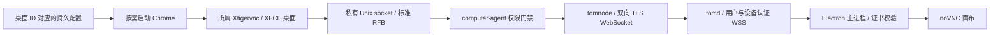

# Bot 电脑观看与接管

采用标准 RFB/noVNC 远程桌面：云端渲染，客户端接收屏幕更新并在授权后回传键鼠。项目原有 TigerVNC 的 `Xtigervnc` 同时提供 X11 显示和 VNC 服务，可替代 Xvfb + x11vnc 组合；受信 Go 网关完成 WebSocket 转发，不额外开放 5900/6080 端口。没有 WebRTC 或自定义图像流协议。

每个桌面的 Chrome 直接显示在自己的 X11 屏幕上。登录、退出和账号切换作用于该桌面的持久配置。

## 观看与控制

`POST /api/v2/bots/{botID}/console` 创建只读观看记录。`heartbeat` 续约并启动对应显示服务；`stream` 提供标准 RFB WebSocket。`takeover` 申请独占控制，工作器在模型/工具边界交接，确认运行 Bot 和 Shell 的 cgroup 已冻结。桌面及其 Chrome 不冻结，其他 Bot 继续运行。

接管期间，服务端只接受所属观看者的 RFB 键鼠消息。`release` 撤销输入并释放按键和鼠标，再解除冻结，原运行继续执行，画面连接保持不变。`close` 结束观看并交还控制，不取消原任务。只读客户端即使自行发送键鼠包，也会被容器代理丢弃；noVNC 的 `viewOnly` 只负责交互表现，不能代替服务端权限检查。

空闲观看创建不调用模型的电脑运行；若出现新聊天，只读空闲运行让出执行槽位。正常运行结束、电脑重建或租约结束时关闭当前观看连接，界面提示重新连接，不复用旧桌面身份。观看每 30 秒到期，心跳续约总长最多 10 分钟；设备和电脑授权每秒复查。网络断线不重放键鼠，工作器在租约到期后恢复任务；解除冻结未确认则停止运行并报告失败。

屏幕固定 1280×800，客户端仅缩放显示。常规键鼠由 noVNC 编码，中文输入框发送 Unicode keysym。文件通过资料库与 `/workspace` 传输，浏览器默认下载到 `/workspace/Downloads`。远程 VNC 剪贴板、改分辨率和电源控制不开放。

## 认证、资源和性能

电脑代理每次连接核验 Unix socket 的 UID/GID、0600 权限、对端 PID、cgroup 和完整执行身份。转发始终由代理持有，回收会话会断开已交付的连接。节点通道核验双向 TLS 证书指纹；用户通道沿用登录设备认证和持久授权。主进程保管认证头和服务证书，渲染进程只收到 RFB 字节，地址和凭据不会进入 URL、日志或网页。

每桌面最多 4 条底层流，业务层同一 Bot 只允许一个活动观看设备。客户端最多 8 条流；未确认接收的画面超过 2 MiB 时关闭连接。代理读客户端包有长度上限，写入慢端超过 5 秒关闭。画面采用 noVNC/TigerVNC 支持的 RFB 编码和增量更新，不再进行 PNG 定时全屏轮询。容量按实际同时运行的桌面和 Chrome 实例数评估。

## 部署、迁移和回滚

成套发布桌面客户端、`tomd`、`tomnode` 与电脑镜像。按桌面登录、节点配置、保盘换镜像和回滚步骤见[浏览器部署说明](browser-readiness.md)。网关只允许固定服务入口，反向代理需支持 `/api/v2/consoles/{id}/stream` 的 WebSocket Upgrade，空闲超时应至少覆盖 10 分钟；不开放容器 VNC 或调试端口。

迁移 0076 增加观看/控制记录、控制代次、无模型运行来源及索引；0077 增加只读状态和交还后继续观看的标记，并重建单 Bot 活动观看唯一索引。迁移不读取画面、账号或键盘内容，不修改历史迁移。表结构变更短暂取得排他锁；新表尚无存量时耗时很短，已有大量观看历史时唯一索引重建时间随表规模增长，需停单维护窗口并检查锁等待。协议新增 `desktop_connect` 文件描述符交付、节点 `/v2/desktop` WebSocket，以及 6 个 cgroup 控制描述符，不提供旧协议兼容层。

升级前停止新任务领取，等待运行和观看结束，确认资源回收，再迁移数据库和切换配套程序、镜像，完成能力验证后恢复。回滚也必须先排空流和执行会话，再恢复匹配的旧程序与镜像，保留 `/workspace`、Chrome profile 和运行账本。数据库已执行的迁移不可删除或改写；若需要还原约束，应新增更高版本前向迁移，不直接回退历史脚本。

## 验证范围

- RFB 单元测试：分片消息、只读输入阻断、接管后输入、交还时释放按键/鼠标、非法扩展、剪贴板上限、取消与半关闭。
- 节点真实 TLS 测试：指纹固定、查看者归属、跨 WebSocket 字节完整性、连接超过普通调用预算、退出回收。
- 真实 PostgreSQL 测试：用户/设备隔离、只读启动、接管与恢复、到期回收、失败状态、原任务模型和工具不重放。
- Linux TigerVNC 集成：真实全帧、1280×800 尺寸、只读鼠标阻断、接管输入到达 X11、交还撤权和错误 Bot 拒绝。该测试使用容器根 cgroup，冻结的单元测试不等同于实际生产 cgroup 联合验收。
- 有头 Google Chrome 集成：双桌面并发输入、独立 Cookie、关闭和异常退出隔离，以及重建后的登录恢复。
- 客户端测试：noVNC 画面渲染、同连接切换权限、坐标缩放、中文输入、滚轮不滚动外层、全屏和关闭；IPC 的窗口归属、缓冲上限、超时和异常输入。
- `desktop/tests/e2e/console.spec.ts` 使用隔离的真实 Electron 和预加载桥接验证 RFB 解码及权限切换，业务回包与 RFB 服务由夹具提供；不会连接用户的真实服务。旧 `desktop.spec.ts` 的配套服务启动夹具仍依赖已移除的旧版接口，不包含在此次端到端通过范围内。

尚未部署生产。生产节点必须额外验收真实 cgroup 冻结、电脑重建、反向代理 WSS 与完整开户链路。

noVNC 1.7.0 使用 MPL-2.0：[项目与源代码](https://github.com/novnc/noVNC)、[许可证](https://github.com/novnc/noVNC/blob/v1.7.0/LICENSE.txt)、[RFB API](https://novnc.com/noVNC/docs/API.html)。客户端将其作为未修改的依赖打包，发布时应保留依赖许可证及源码获取说明。
