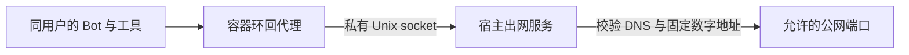

# 用户电脑受控出网

本模块提供用户电脑的 HTTP 与 CONNECT 公网转发，以及容器内环回 TCP 到宿主 Unix socket 的转接。没有模型配置、业务数据库连接、网站凭据存储或通用节点管理接口。

容器使用 Docker `network=none`，仅保留环回网络。移除桥接接口后，用户代码不能绕过代理直接连接宿主、其他用户容器或公网；DNS 解析和出站连接由宿主服务执行。[Docker none 网络说明](https://docs.docker.com/engine/network/drivers/none/)

## 身份与资源边界

一个 `Server` 固定一个用户、电脑、容器 ID 和实例代次，仅在 root 私有 Unix 流端点监听。接受连接时先验证 Linux `SO_PEERCRED` 的 root UID/GID，再调用必填的 `PeerCheck`，由节点复验该进程属于固定实际容器。不能用 HTTP 头、用户声明或仅检查 root 代替容器身份校验。`Listen` 在 root 保护目录持有稳定文件锁；已有端点只有确认身份匹配且内核返回无监听者时才允许清理。活监听、普通文件、链接或权限异常明确拒绝。关闭前复验 inode，端点被替换时保留未知文件，锁文件不删除。

容器内 `Bridge` 仅接受 IPv4 环回监听。正式代理使用环境模板定义的地址，单次连接固定控制目录的 `egress.sock`，验证宿主 root 在容器 PID 命名空间中的 PID 为 0。缺失端点返回 502；同容器 root 不能冒充宿主。控制 RPC 与出网监听共同监督，任何异常退出都不能留下仍接单的半套代理。

连接数按用户电脑限制；普通请求与 CONNECT 都限制连接、空闲、总传输及停服时长。请求和响应各有字节上限，隧道与环回转接按两个方向分别限制。取消会关闭普通连接和已劫持隧道，等待工作者回收；限额、未知结果和关闭失败明确报告，不自动重发用户动作。`Drain` 提供独立的实际回收确认：`Serve` 超时返回不等于工作者已结束，节点不能据此释放端点锁。

## 目标和协议策略

部署必须显式提供允许端口及可选拒绝网段。每次连接重新解析 DNS，最多接受 16 个结果；任一结果属于私网、环回、链路本地、元数据、保留或转换地址、宿主网卡地址、部署拒绝网段，就拒绝整次连接。校验后只连接一个数字地址，不再次解析或切换地址重发。宿主经 NAT 映射的公网地址及基础设施公网地址不一定出现在网卡上，部署必须将它们加入拒绝网段。

普通代理请求只接受规范的 HTTP 绝对 URL，并核对 Host 一致。CONNECT 使用严格的主机与端口语法；TLS 在客户端与网站之间保持端到端，不解密或替换证书。重定向原样返回，由后续请求重新校验目标，不由代理跟随。CONNECT 可承载允许端口上的双向协议，不能仅凭端口把内容视为 HTTP。

转发删除代理凭据、逐跳头与其声明的字段，不转发升级响应，不保留可重发正文。Go 标准 HTTP 解析可能提前移除含 `close` 的 `Connection`，因此响应解析前有界捕获其声明的字段名，避免遗漏清理；不保留这些字段的值。响应头合计最多 32 KiB，未知长度响应超限会中断连接，不能以正常结束掩盖截断。

业务请求内容、URL、网站凭据及原始网络错误不进入日志。日志使用固定原因，并携带所属用户与电脑标识。

## 验证与接入状态

常规测试使用本地 HTTP/TLS 服务验证真实请求、端到端 TLS、头清理、缓冲 CONNECT 数据、大小限制、DNS 变化与混合地址拒绝、单次发送、连接容量和取消回收；解析和拨号替身只将已验证测试公网地址映射到测试监听器，不访问公网。

Linux `egressintegration` 测试在专用 root 受限容器中验证 Unix 内核身份、错误 PID 与非 root 拒绝、端点权限和停服回收。测试授权器核对测试进程 PID，尚不证明生产容器资源组归属或宿主 PID 0 成功连接。容器代理入口另验证宿主端点缺失时返回 502、正常退出释放环回端口。

[节点生命周期](../dockernode/README.md)已接入宿主端点创建、复用、关闭和启动恢复。实际授权实现复验 Docker 容器 ID、标签、运行配置与主进程，再比较主进程和连接对端的 cgroup 路径、设备号及 inode；使用 [processgroup](../processgroup/README.md) 的唯一定位实现，不伪造 Bot 执行会话。

真实 Linux 测试新增稳定锁、活端点拒绝、崩溃遗留端点接管、替换文件保留和工作者退出超时。节点组合测试使用真实 Unix 监听和 HTTP 代理，验证恢复、环回目标拒绝及删除前连接收尾；该测试的 Docker/cgroup 定位仍是替身，不能代替宿主实际容器归属验收。

**独立节点程序、完整出网能力探针及宿主实际容器联合验收仍未完成。** 当前没有把模块测试当作开户就绪；共享 Chrome 还须显式配置代理并与完整窗口服务联合验收。

## 部署、恢复与回滚

本次替换原内部桥接设计：生命周期记录版本 2、代理配置版本 3、镜像及共享环境模板须配套部署；桌面会话记录仍为版本 2。已有中间环境先用原程序排空并清理旧容器和网络，保留成套备份，再建立新环境。新程序拒绝旧记录，不转换或跳过；数据库历史迁移没有修改。

回滚先停止新实例并确认连接和任务结束，恢复相匹配的程序、镜像与状态，不能仅退回旧二进制或改版本字段。节点重启先由会话控制器回收全部旧执行，再按持久生命周期记录逐批恢复端点，不能提前给旧进程开放网络。恢复失败关闭已建立端点并中止启动，不修改旧任务期限或资源代次；在完成能力探测前不得接纳电脑执行。
